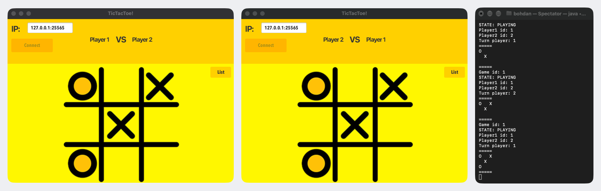
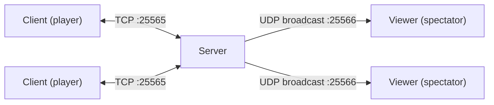

# tictactoe-network

[](https://github.com/shb327/tictactoe-network/actions/workflows/build.yml)

Networked tic-tac-toe in Java: a TCP game server, a JavaFX client for players and a console viewer that follows every game over UDP broadcast.

<!--
  SCREENSHOT: two clients mid-game with the viewer's terminal beside them.
  Save it as docs/demo.png (or docs/demo.gif) and uncomment the line below.
-->
<!--  -->

## How it works



The server pairs players in the order they send `PLAY`, keeps the board and turn for each game, and sends every move to both players and, as a UDP broadcast, to any viewers.

## Protocol

Messages are written with Java's `DataOutputStream`: strings as `writeUTF`, numbers as big-endian `int` or `byte`.

| Command | Direction | Meaning |
|---|---|---|
| `PLAY` | client → server | Join the queue; the next player to join starts a game with you. |
| `SET x y gameId` | client → server | Place your mark at column `x`, row `y` (0–2). Ignored unless it is your turn and the cell is empty. |
| `LIST` | client → server | Ask for all connected players. |
| `LOGOUT` | client → server | Leave the queue and disconnect. |
| `NEWGAME gameId selfId opponentId turnId` | server → client | A game has started; `turnId` moves first. |
| `UPDATE gameId state player1Id player2Id turnId cells[9]` | server → client | Sent after every accepted move. `state` is `PLAYING` or `END <winnerId>` (`END 0` is a draw). Cells row by row: 0 empty, 1 X, 2 O. |
| `LIST count (id address)…` | server → client | Reply to `LIST`. |
| `UPDATE …` | server → viewers (UDP) | The same `UPDATE` message, broadcast for spectators. |

## Run

Needs JDK 17 or newer to run Gradle; Java 21 for the apps is downloaded automatically if it isn't installed.

```bash
./gradlew :server:run                        # TCP 25565, broadcasts on UDP 25566
./gradlew :server:run --args="25565 25566"   # <server port> <broadcast port>

./gradlew :viewer:run                        # listens on UDP 25566
./gradlew :viewer:run --args="25566"         # <broadcast port>

./gradlew :client:run                        # enter 127.0.0.1:25565 and press Connect
```

Start two clients to play a game. The client expects an IPv4 address and port, e.g. `127.0.0.1:25565`.

## Test

```bash
./gradlew build
```

Unit tests cover the game rules (turns, every winning line, draws, rejected moves) and parsing of client commands. An integration test starts the server on a free port, connects two socket clients and plays a game to a win. The JavaFX UI is not tested.

---

Started in 2021 as a university project.
